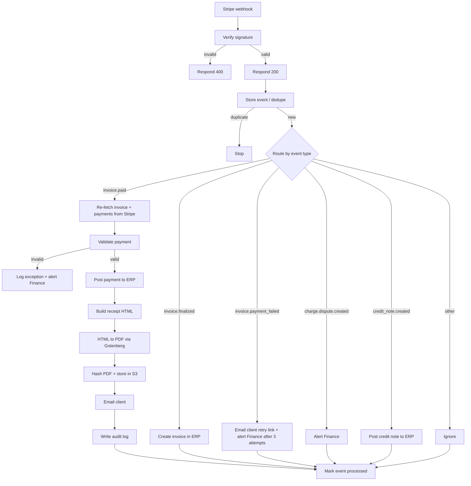

# AI Payment Automation (n8n)

An [n8n](https://n8n.io) workflow that takes a client payment from "received" to "verified, recorded, receipted and emailed" with no manual steps, and leaves a full audit trail behind.

It is built for B2B finance teams. Instead of someone checking a payment dashboard, updating the accounting system, building a receipt and emailing the client, this workflow does it in seconds and sends anything unusual to a person.

> **Status:** reference implementation built for Stripe. It has been syntax-checked but not load-tested in production, so run it in test mode first. A Paystack version is planned (see [Roadmap](#roadmap)).

---

## What it does

When a client pays an invoice, the workflow:

1. **Receives** the payment notification (webhook) and **verifies its signature**
2. **De-duplicates** it, so the same event can never be processed twice
3. **Re-checks** the payment directly with the payment provider
4. **Validates** the amount, currency, customer email and ERP customer ID
5. **Posts** the payment to your ERP (idempotent, so retries are safe)
6. **Generates** a branded PDF receipt, fingerprints it with a SHA-256 hash, and stores it in S3
7. **Emails** the receipt to the client (with a copy to Finance)
8. **Writes an audit log** entry recording exactly what happened

It also handles failed payments, disputes and credit notes. Payments that fail validation are never posted. They go to an exception queue and Finance is alerted.

---

## How it works



### Design principles

- **Webhooks drive everything.** Nothing is marked paid because a customer landed on a success page.
- **Never trust the first message.** The payment is re-fetched from the provider and compared with what the webhook claimed.
- **Deterministic code handles money.** Amounts, tax and numbering are rules-based, and the figures in emails and receipts are injected from data, never generated by AI.
- **Idempotent everywhere.** Events are de-duplicated by ID, and ERP calls carry an `Idempotency-Key`.
- **Humans handle exceptions.** Anything that doesn't match goes to a review queue instead of auto-posting.
- **Auditable.** Raw events are kept, receipts are hashed and stored immutably, and the audit log is append-only.

---

## Events handled

| Stripe event | What the workflow does |
|---|---|
| `invoice.finalized` | Creates the invoice in the ERP (Dr Accounts Receivable, Cr Revenue and Tax) |
| `invoice.paid` | Full path: verify, validate, post to ERP, receipt, email, audit |
| `invoice.payment_failed` | Emails the client a retry link; alerts Finance after 3 failed attempts |
| `charge.dispute.created` | Alerts Finance with the dispute reason and evidence deadline |
| `credit_note.created` | Posts the credit note to the ERP |
| anything else | Recorded and ignored |

---

## Repository contents

| File | Purpose |
|---|---|
| `n8n_workflow_1_stripe_client_payment.json` | The workflow. Import by pasting onto an n8n canvas. |
| `schema.sql` | Postgres tables: event store, exception queue, audit log |
| `README.md` | This file |

---

## Prerequisites

- **n8n** (self-hosted or cloud). Self-hosted needs the env var `NODE_FUNCTION_ALLOW_BUILTIN=crypto`, which the signature check requires.
- **Stripe account** (test mode is free) with an API secret key and a webhook signing secret
- **PostgreSQL**, for the event store, exceptions and audit log
- **SMTP provider** for email (for example Brevo, Postmark or Amazon SES)
- **S3-compatible bucket** for receipt PDFs
- **Gotenberg** (HTML to PDF), for example `docker run -p 3000:3000 gotenberg/gotenberg:8`
- **An ERP or accounting system** with an HTTP API (see [ERP integration](#erp-integration))

---

## Setup

### 1. Create the database tables

```bash
psql -h <host> -U <user> -d <database> -f schema.sql
```

### 2. Start n8n with the crypto module enabled

```bash
# macOS / Linux
NODE_FUNCTION_ALLOW_BUILTIN=crypto n8n start

# Windows PowerShell
$env:NODE_FUNCTION_ALLOW_BUILTIN="crypto"; n8n start
```

### 3. Import the workflow

Open `n8n_workflow_1_stripe_client_payment.json`, copy everything, and paste it onto a blank n8n canvas (Ctrl/Cmd+V).

### 4. Edit the configuration

- In the **Verify Signature** node, replace `whsec_REPLACE_ME` with your Stripe webhook signing secret. For production, move this to an environment variable or secret store.
- In the **Config & Event** node, set:

| Key | Meaning |
|---|---|
| `company_name`, `company_address`, `company_tax_id` | Shown on the receipt |
| `from_email` | Sender address (must be verified with your SMTP provider) |
| `finance_email` | Receives alerts and a BCC of every receipt |
| `erp_base_url` | Base URL of your ERP API |
| `gotenberg_url` | Where Gotenberg is running |
| `s3_bucket` | Bucket for receipt PDFs |
| `stripe_api_version` | Pinned Stripe API version (default `2025-03-31.basil`) |
| `template_version` | Receipt template version, included in the stored file name |

### 5. Add credentials in n8n

| Node(s) | Credential |
|---|---|
| Get Invoice (Stripe), Get Invoice Payments | Stripe API |
| Store Event, Log Exception, Write Audit Log, Mark Event Processed | Postgres |
| Send Receipt Email, Email Client, Alert Finance (x3) | SMTP |
| Store PDF (S3) | AWS S3 |
| ERP: Create Invoice, Post Payment, Post Credit Note | Header Auth |

### 6. Connect Stripe

Create a webhook endpoint in Stripe pointing to your n8n **production** URL:

```
https://<your-n8n-host>/webhook/stripe-client-payments
```

Subscribe it to: `invoice.finalized`, `invoice.paid`, `invoice.payment_failed`, `charge.dispute.created`, `credit_note.created`.

**Local testing** with the [Stripe CLI](https://stripe.com/docs/stripe-cli) (it prints a `whsec_...` secret to use in step 4):

```bash
stripe listen \
  --events invoice.finalized,invoice.paid,invoice.payment_failed,charge.dispute.created,credit_note.created \
  --forward-to localhost:5678/webhook/stripe-client-payments
```

Then activate the workflow and trigger test events with `stripe trigger invoice.paid`. Note that some fixture events lack the `erp_customer_id` metadata and will correctly land in the exception queue.

### 7. Required Stripe customer metadata

| Metadata key | Required | Purpose |
|---|---|---|
| `erp_customer_id` | Yes | Links the payment to the customer record in your ERP |
| `billing_cc` | No | Comma-separated CC addresses for receipts |

---

## ERP integration

The ERP steps are generic HTTP nodes, so you adapt them to your system (NetSuite, Xero, QuickBooks, Dynamics, SAP, Odoo, or a custom API). The workflow sends:

| Call | Endpoint (change to suit) | Idempotency key |
|---|---|---|
| Create invoice | `POST /invoices` | `stripe-invoice-finalized-<invoice_id>` |
| Post payment | `POST /cash-receipts` | `stripe-invoice-paid-<invoice_id>` |
| Post credit note | `POST /credit-notes` | `stripe-credit-note-<credit_note_id>` |

Suggested ledger treatment (Stripe acts as a clearing account because cash reaches the bank at payout time):

1. **Invoice finalized:** Dr Accounts Receivable, Cr Revenue (or Deferred Revenue), Cr Tax Payable
2. **Invoice paid:** Dr Stripe Clearing, Cr Accounts Receivable
3. **Payout to bank:** Dr Bank, Dr Processor Fees, Cr Stripe Clearing (not in this workflow, see Roadmap)

---

## Database tables

| Table | Purpose |
|---|---|
| `stripe_events` | Every event received, with raw payload and status (`received`, `processed`, `exception`). The primary key on `event_id` is the dedupe mechanism. |
| `finance_exceptions` | Payments that failed validation, with reasons, ready for a human to resolve |
| `audit_log` | Append-only record of actions (receipt hash, S3 key, recipient, references). A trigger blocks updates and deletes. |

To find events that never finished (useful for an alert):

```sql
SELECT event_id, event_type, received_at
FROM stripe_events
WHERE status = 'received' AND received_at < now() - interval '15 minutes';
```

---

## Security and controls

- **Signature verification** on the raw request body, with a 5-minute replay window and constant-time comparison
- **Dedupe by event ID** at the database level
- **Double verification:** the webhook is cross-checked against a fresh API call
- **No raw card data.** Only Stripe IDs and the last 4 digits of cards are used
- **Immutable receipts:** SHA-256 hash recorded in the audit log. Enable S3 versioning or Object Lock so stored files cannot be overwritten.
- **Append-only audit log** enforced by a database trigger
- **Least privilege:** use a restricted Stripe key with read-only access to invoices, customers, payment intents and charges
- **Never commit secrets.** Keep keys and passwords out of the repository

---

## Known limitations

- **Not production-hardened.** Treat it as a strong starting point, and test thoroughly in Stripe test mode first.
- **ERP nodes are placeholders** and must be mapped to your system's real endpoints and fields.
- **The webhook secret is a constant** in a Code node. Move it to an environment variable or secret store.
- **A failed run leaves the event in `received` status.** Set an Error Workflow in n8n and use the stuck-events query above.
- **No delivery tracking.** Plain SMTP gives no bounce or complaint events. Use Postmark or SES with delivery webhooks if you need them.
- **Large invoices:** webhook payloads can truncate long line-item lists, and `invoice.finalized` posts a `lines_truncated` flag when that happens.
- **No country e-invoicing formats** (for example Italy's SDI or Poland's KSeF). The PDF may not be a legal invoice in those jurisdictions.
- **Single legal entity** is assumed.

---

## Troubleshooting

| Problem | Likely cause |
|---|---|
| Webhook returns 400 | Wrong signing secret, or n8n isn't receiving the raw body (check the webhook node's Raw Body option) |
| Code node error: `Cannot find module 'crypto'` | `NODE_FUNCTION_ALLOW_BUILTIN=crypto` is not set |
| Workflow stops after "Store Event" | The event ID already exists, so it was correctly treated as a duplicate |
| Payment lands in `finance_exceptions` | See the `reasons` column. Often a missing `erp_customer_id`, or an amount or currency mismatch. |
| Receipt step fails | Gotenberg isn't reachable from n8n. Check `gotenberg_url` (use `host.docker.internal` if n8n is in Docker) |
| Email rejected | `from_email` isn't a verified sender, or your server's IP isn't authorized with the SMTP provider |
| Stripe can't reach local n8n | Use the Stripe CLI, or a tunnel such as Cloudflare Tunnel or ngrok |

---

## Roadmap

- [ ] Paystack version for businesses in markets Stripe doesn't support
- [ ] Daily reconciliation: Stripe payouts vs bank statement vs ERP
- [ ] Scheduled "stuck events" and missed-event checks
- [ ] Refund approval flow with segregation of duties
- [ ] Delivery tracking for receipt emails (bounces and complaints)
- [ ] Country e-invoicing adapters
- [ ] AI-assisted exception triage (suggested matches for payments with no reference)

---

## Contributing

Issues and pull requests are welcome. Please do not include real credentials, customer data or live webhook payloads in issues or commits.

## License

MIT (change this to the license you prefer, and add a `LICENSE` file).

## Author

Built by **Charles**, AI automation specialist. Contact: `your-email@example.com`
